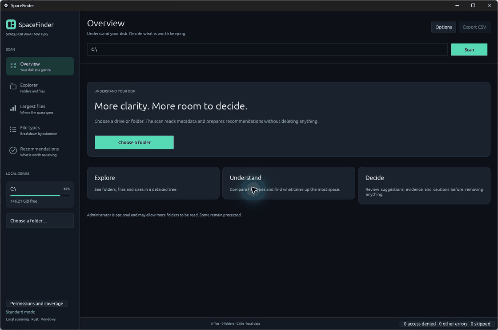
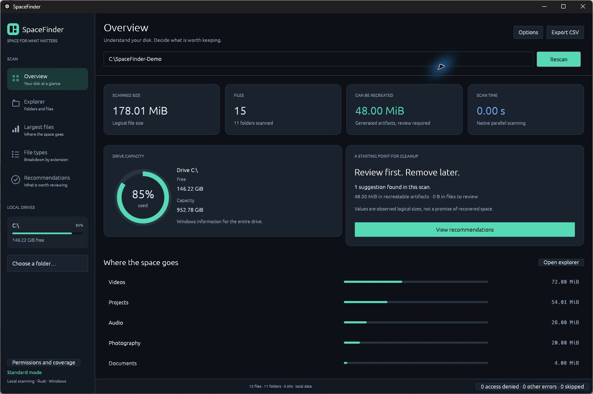
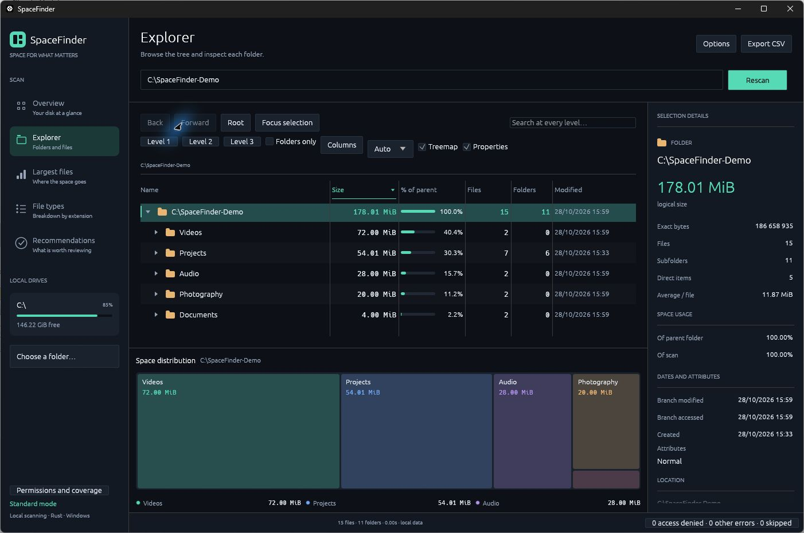
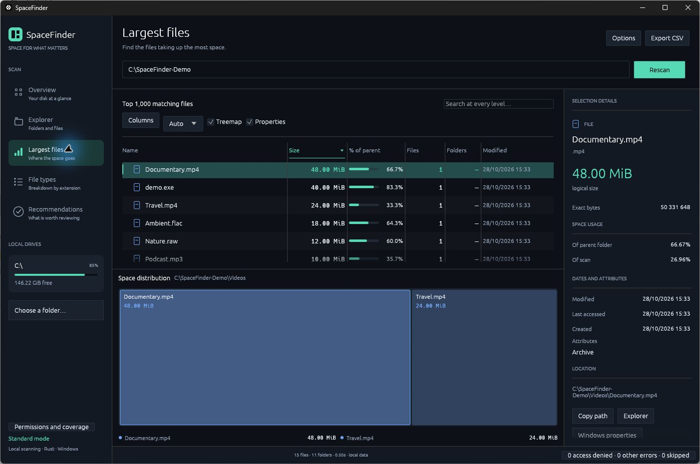
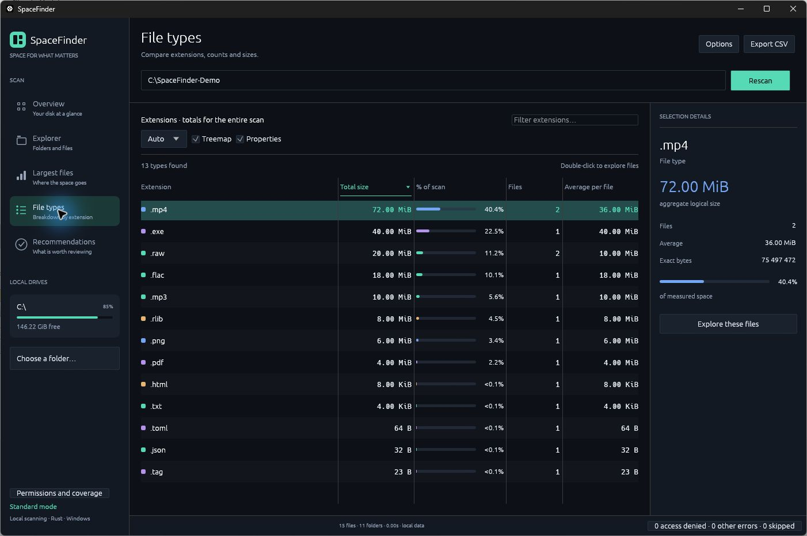
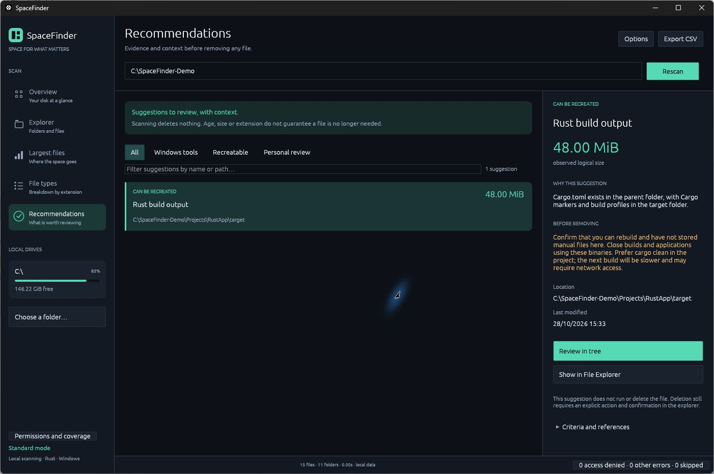

<p align="center">
  
</p>

<p align="center">
  <strong>Understand your disk. Find what takes up space. Decide what is worth keeping.</strong>
</p>

<p align="center">
  
  
  
  <a href="LICENSE"></a>
</p>

<p align="center">
  <a href="#getting-started">Getting started</a> ·
  <a href="#in-action">In action</a> ·
  <a href="#features">Features</a> ·
  <a href="#command-line">CLI</a> ·
  <a href="docs/GUIDE.md">Detailed guide</a>
</p>

**SpaceFinder** is a native Windows disk space explorer written in Rust. Scan a folder or drive, see where the space goes, and review suggestions backed by evidence and context. An English interface, local processing, and no browser, server or JavaScript runtime.

## In action



[Watch the MP4 demonstration](docs/assets/demo.mp4) · [View full-size screenshots](#screenshots)

*An edited walkthrough of real captures from the English application, held for readability, using synthetic demo files. This is not a real-time recording or a benchmark. The banner is an AI-generated brand illustration; the application screenshots are real captures.*

## Features

| View | What you can see |
| --- | --- |
| **Overview** | Scanned size, file count, drive capacity and largest folders. |
| **Explorer** | Expandable tree, treemap, search across every level and selection properties. |
| **Largest files** | The top 1,000 matching files, with filtering and sorting. |
| **File types** | Breakdown by extension, counts, averages and access to matching files. |
| **Recommendations** | Suggestions to review, with reasons, cautions and inspection actions. |

- **Background scanning:** multiple threads, progress reporting and cancellation with partial results.
- **Windows integration:** open items, show them in File Explorer and inspect native properties.
- **Export and automation:** UTF-8 CSV and a CLI with text or JSON output.
- **Visible coverage:** access-denied folders, other errors and skipped links are reported explicitly.
- **Controlled deletion:** move items to the Recycle Bin only through an explicit action and confirmation; folders require typing their name.

## Screenshots

<details>
<summary><strong>Explore all five views</strong></summary>

### Overview



### Explorer



### Largest files



### File types



### Recommendations



</details>

## Getting started

### Build from source

Requires **stable Rust** with edition 2024 support and the **MSVC build tools for Windows**.

```powershell
git clone https://github.com/snaffey/SpaceFinder.git
cd SpaceFinder
./build.ps1
```

The build creates two portable executables:

| File | Purpose |
| --- | --- |
| `dist/SpaceFinder.exe` | Graphical application; double-click to launch. |
| `dist/SpaceFinder-CLI.exe` | Terminal scans and JSON output. |

You can also run directly with Cargo:

```powershell
cargo run --release
cargo run --release -- 'C:\Users'
```

### Run your first scan

1. Select a drive, enter a path or use **Choose a folder**.
2. Click **Scan** and explore the results using the sidebar.
3. Open **Recommendations** to see what deserves a closer look.
4. Use **Export CSV** to save the results.

**Administrator is optional.** The application works in standard mode. **Run as administrator** may improve coverage, but some locations remain protected. The application does not change permissions or file ownership.

## Recommendations with context

| Category | Examples | Next step |
| --- | --- | --- |
| **Manage with Windows** | Standard temporary-file locations, Recycle Bin, `Windows.old`. | Open the Windows tool and review available options. |
| **Can be recreated** | Cargo and Next.js artifacts recognized through manifests and output markers. | Confirm the project can be rebuilt and no manual files are stored there. |
| **Personal review** | Large personal files and old downloads matching the engine's criteria. | Inspect the file and decide whether it is still needed. |

**Recommendations never clean up automatically.** Size, age and extension do not prove a file can be deleted. **Review in tree** only selects the item. Full criteria, exclusions and limits are documented in the [detailed guide](docs/GUIDE.md#recommendations).

## Command line

```powershell
# Text summary with 8 workers
.\dist\SpaceFinder-CLI.exe --scan 'C:\Users' --threads 8

# Structured output
.\dist\SpaceFinder-CLI.exe --scan 'C:\Users' --json

# Include recommendations
.\dist\SpaceFinder-CLI.exe --scan 'C:\Users' --json --recommendations
```

| Option | Effect |
| --- | --- |
| `--scan <path>` | Sets the folder or drive to scan. |
| `--threads <1–64>` | Sets the worker count. The automatic default depends on CPU count and is capped at 16. |
| `--json` | Outputs statistics, issues, extensions and the 30 largest root entries as JSON. |
| `--recommendations` | Adds suggestions, reasons and cautions to text or JSON output. |

## How space is measured

On Windows, the scanner uses `FindFirstFileExW` and `FindNextFileW`. It collects sizes and other metadata during enumeration without reading file contents. Enumeration runs in parallel, with bounded queues and virtualized UI tables.

- Sizes are **logical**, in bytes and binary units (KiB, MiB, GiB). They may differ from the physical space used by compressed or sparse files.
- **Hard links are counted by path.** Reparse points, including junctions and symbolic links, are skipped to avoid cycles and crossing volumes.
- An inaccessible folder or canceled scan produces a **partial result**, clearly indicated in the interface.
- The disk may change during a scan. A scan is not a transactional snapshot and does not detect duplicates by content.

Local measurements and verification history are available in [VALIDATION.md](VALIDATION.md). Performance varies with the disk, cache, antivirus, permissions and folder structure.

## Development

```powershell
cargo fmt --check
cargo clippy --all-targets -- -D warnings
cargo test --all-targets
./build.ps1
```

Tests requiring explicit execution, including the native Recycle Bin test, are ignored by default. The scanner includes a portable `read_dir` implementation; the application and File Explorer integration target Windows.

Found a problem? [Open an issue](https://github.com/snaffey/SpaceFinder/issues) with reproduction steps, your Windows version and the expected behavior. Remove personal paths from reports before sharing them.

## License

Distributed under the [MIT license](LICENSE).
